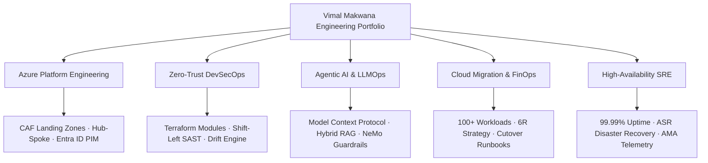
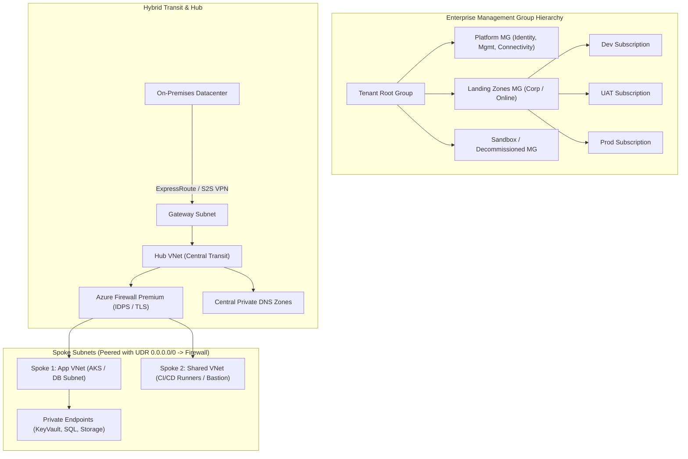
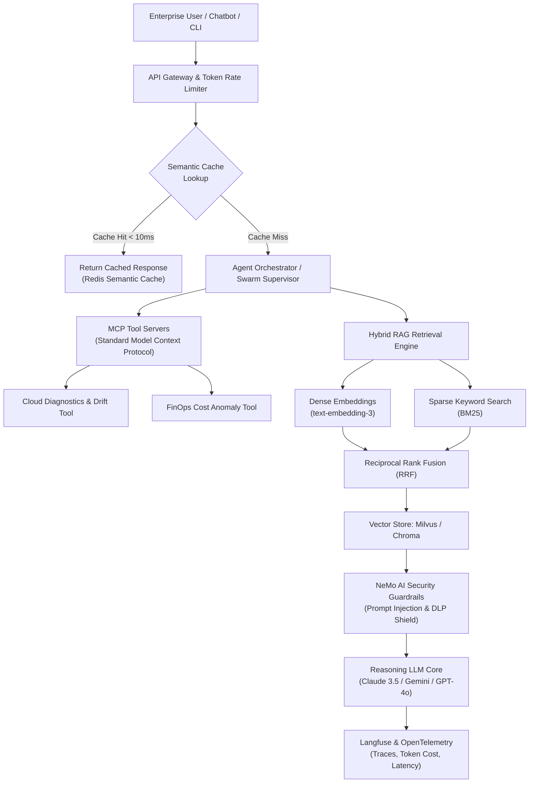

<!-- HERO BANNER -->

<!-- ANIMATED HEADLINE -->

### DevSecOps & Cloud Platform Architect · Agentic AI & LLMOps · Microsoft Azure · Terraform

**Secure cloud foundations. Autonomous AI platforms. Resilient systems at scale.**

---

## 👋 About Me

I am a **DevSecOps & Cloud Platform Architect** and **AI Systems Engineer** focused on Microsoft Azure, Enterprise Landing Zones (CAF), Infrastructure as Code (Terraform), and next-generation **Agentic AI Infrastructure (Model Context Protocol / MCP & Enterprise RAG)**.

I use this GitHub portfolio to document production reference architectures, automated CI/CD quality gates, migration playbooks, and secure AI system designs. My professional focus is on making infrastructure **repeatable, secure by design, financially governed, and autonomously intelligent**—from multi-subscription landing zones and shift-left security to self-healing agentic workflows.

- 📍 Based in India · Open to High-Impact Global & Remote Roles
- 🎯 Focus: DevSecOps, Cloud Architecture (Azure/AWS), Agentic AI / LLMOps, 100+ Workload Migration, FinOps, and SRE
- 🧱 Core Tooling: Terraform, Azure CAF, Kubernetes (AKS), GitHub Actions, Model Context Protocol (MCP), Python, Checkov, Milvus
- 🤝 [Connect with me on LinkedIn](https://www.linkedin.com/in/vimal-makwana09/)

> **Portfolio Principle:** Cloud infrastructure and AI systems must be observable, governed by Zero-Trust policy, and financially defensible. A green CI/CD badge alone is not proof of production readiness—true resilience requires automated drift detection, verified failover runbooks, and strict policy-as-code guardrails.

---

## 🧭 Portfolio Architecture

---

## 🧰 Technology Stack

| Area | Tools, Frameworks & Production Practices |
|:---|:---|
| ☁️ **Cloud Platforms** | Microsoft Azure (CAF Enterprise Landing Zones, Hub-Spoke VNet peering, Azure Firewall Premium, Entra ID PIM, Key Vault), AWS multi-tier fundamentals |
| 🏗️ **Infrastructure as Code** | Terraform, Terragrunt, Azure Bicep, reusable modules, remote state lease-locking in Azure Blob, automated drift detection (`-detailed-exitcode`) |
| 🔄 **DevSecOps & CI/CD** | GitHub Actions, Azure DevOps Pipelines, trunk-based delivery, automated PR speculative plans, Infracost budget gates, multi-stage approval gates |
| 🔐 **Cloud Security & Policy** | Checkov, Trivy, GitLeaks, Azure Policy initiatives (CIS Benchmark v2.0, MCSB), least privilege RBAC, private endpoints, network micro-segmentation |
| 🤖 **Agentic AI & LLMOps** | Model Context Protocol (MCP), LangChain, LlamaIndex, Milvus / Chroma Vector DBs, Hybrid Search (Dense + BM25), Redis Semantic Cache, NeMo Guardrails |
| 📦 **Containers & Mesh** | Docker, Azure AKS, Kubernetes HPA autoscaling, Helm v3 charts, Istio Service Mesh, Cilium eBPF network security |
| 📊 **Observability & SRE** | Azure Monitor Agent (AMA), Data Collection Rules (DCR), Log Analytics KQL alerting, Prometheus, Grafana, P99 latency SLIs, incident war rooms |
| 💰 **FinOps Engineering** | Infracost, automated zombie asset reclamation (orphaned disks/IPs), 95th-percentile rightsizing, 1-yr/3-yr Savings Plans & Reserved Instances |
| 💻 **Languages & Scripting** | Python 3.12, GNU Bash, PowerShell 7, Golang, SQL / KQL |

---

## 🎯 Target Production Impact & SLA Benchmarks

| Production Dimension | Engineering Implementation | Measurable SLA / Benchmark |
|:---|:---|:---|
| **High Availability SLA** | Multi-Zone VMSS, Zone-Redundant Storage (ZRS), Azure Front Door global routing | **99.99% Uptime** ($\le 52.6\text{ mins}$ annual downtime) |
| **Enterprise Cloud Migration** | 4-Wave 6R rationalization with pre-flight automated dependency mapping | **100+ Enterprise Workloads** with zero data loss cutover |
| **FinOps Cost Optimization** | Serverless cleanup daemons, compute rightsizing, and DCR log ingestion filtering | **25% – 35% Annual TCO Reduction** in cloud spend |
| **Zero-Trust DevSecOps** | Shift-left SAST, container CVE scans, secret detection, and policy-as-code | **100% Policy Compliance** before infrastructure apply |
| **Disaster Recovery (DR)** | Multi-region Azure Site Recovery (ASR) replication with automated failover | **RTO ≤ 60 Mins** \| **RPO ≤ 15 Mins** |
| **Agentic AI Performance** | Redis semantic caching with Reciprocal Rank Fusion (BM25 + Dense Vectors) | **<10ms Cache Latency** \| **50%+ LLM Token Cost Reduction** |

---

## 🏛️ Signature Architecture Blueprints

### 1. Enterprise Hub-and-Spoke & CAF Landing Zone Architecture

### 2. Zero-Trust DevSecOps "Golden Path" CI/CD Pipeline

```mermaid
flowchart LR
    Commit["PR / Commit"] --> BranchPolicy["1. Branch Protection\n(Min 2 Approvals)"]
    BranchPolicy --> Secrets["2. Secret Scanning\n(GitLeaks)"]
    Secrets --> SAST["3. IaC SAST\n(Checkov & Trivy)"]
    SAST --> FinOpsGate["4. FinOps Gate\n(Infracost Cost Delta)"]
    FinOpsGate --> Plan["5. Speculative Plan\n(Terraform Plan)"]
    Plan --> CABApproval["6. Approval Gate\n(Senior Lead Sign-off)"]
    CABApproval --> Apply["7. State-Locked Apply\n(Azure Blob Lease Lock)"]
    Apply --> DriftEngine["8. Nightly Drift Cron\n(terraform plan -detailed-exitcode)"]
```

### 3. Agentic AI & Enterprise RAG Infrastructure (MCP + LLMOps)

---

## 🚀 Featured Production Projects

### 1. ☁️ [Azure Enterprise CAF Landing Zone](https://github.com/Vimal-Makwana09/azure-enterprise-landing-zone)
A production Microsoft Cloud Adoption Framework (CAF) Landing Zone in Terraform. Implements a multi-subscription management group hierarchy (Platform vs Workloads vs Sandbox), Hub-and-Spoke networking with Azure Firewall Premium (IDPS/TLS inspection), forced UDR `0.0.0.0/0` routing, and 100% CIS Azure Benchmark compliance.
- [Repository](https://github.com/Vimal-Makwana09/azure-enterprise-landing-zone)
- [Hub-and-Spoke Topology](https://github.com/Vimal-Makwana09/azure-enterprise-landing-zone#networking)
- [Azure Policy as Code](https://github.com/Vimal-Makwana09/azure-enterprise-landing-zone#governance)
- [Operations Runbook](https://github.com/Vimal-Makwana09/azure-enterprise-landing-zone#runbook)

### 2. 🛡️ [DevSecOps "Golden Path" Pipeline Library](https://github.com/Vimal-Makwana09/devsecops-golden-path-platform)
A zero-trust CI/CD delivery framework built on GitHub Actions and Azure DevOps. Features pre-commit secret scanning with GitLeaks, IaC static analysis via Checkov/Trivy, Infracost budget delta enforcement, and automated nightly drift detection alerting directly to incident channels.
- [Repository](https://github.com/Vimal-Makwana09/devsecops-golden-path-platform)
- [CI/CD Workflow Matrix](https://github.com/Vimal-Makwana09/devsecops-golden-path-platform/actions)
- [Threat Model Document](https://github.com/Vimal-Makwana09/devsecops-golden-path-platform#threat-model)
- [Automated Drift Engine](https://github.com/Vimal-Makwana09/devsecops-golden-path-platform#drift-detection)

---

## 🔐 Core Engineering Principles

- **Infrastructure as Code:** Keep all cloud topology version-controlled, idempotent, modular, and reviewable. Never deploy unreviewed changes via the cloud console.
- **Shift Security Left:** Enforce automated secrets scanning (GitLeaks), container vulnerability checks (Trivy), and IaC policy audits (Checkov) before any PR merges.
- **Zero-Trust Identity & Access:** Enforce Microsoft Entra ID Privileged Identity Management (PIM) with Just-in-Time (JIT) activations and multi-stage approvals. Eliminate permanent administrator access.
- **Defensible Change Management:** Require speculative Terraform plans and Infracost budget delta comments on all PRs before production approval.
- **Financial Engineering (FinOps):** Treat cost as an engineering constraint. Continuously purge zombie assets, rightsize compute based on 95th-percentile metrics, and optimize telemetry ingestion.
- **Autonomous AI Governance:** Agents never execute raw, uninspected shell commands; they interact through structured, audited Model Context Protocol (MCP) tool servers bound by enterprise RBAC.
- **Operational Readiness & Evidence:** Build runbooks, dashboards, smoke tests, and automated rollback triggers for every workload. Document real validation evidence over unsubstantiated claims.

---

## 🎯 Current Engineering Priorities

- 🤖 Developing and publishing standardized open-source **Model Context Protocol (MCP)** tool servers for automated cloud health and drift remediation.
- ☁️ Hardening enterprise **Azure CAF Landing Zone** modules with automated CIS Azure Benchmark v2.0 policy enforcement.
- 🛡️ Expanding shift-left CI/CD pipelines with automated container image signing (**Cosign**) and SBOM generation.
- 📈 Documenting reproducible enterprise migration cutover runbooks, network micro-segmentation blueprints, and KQL telemetry dashboards.

---

### 🤝 Let's Connect & Architect

Interested in opportunities and collaboration around **Enterprise Cloud Architecture, Zero-Trust DevSecOps, 100+ Workload Migration, and Agentic AI Systems**.

